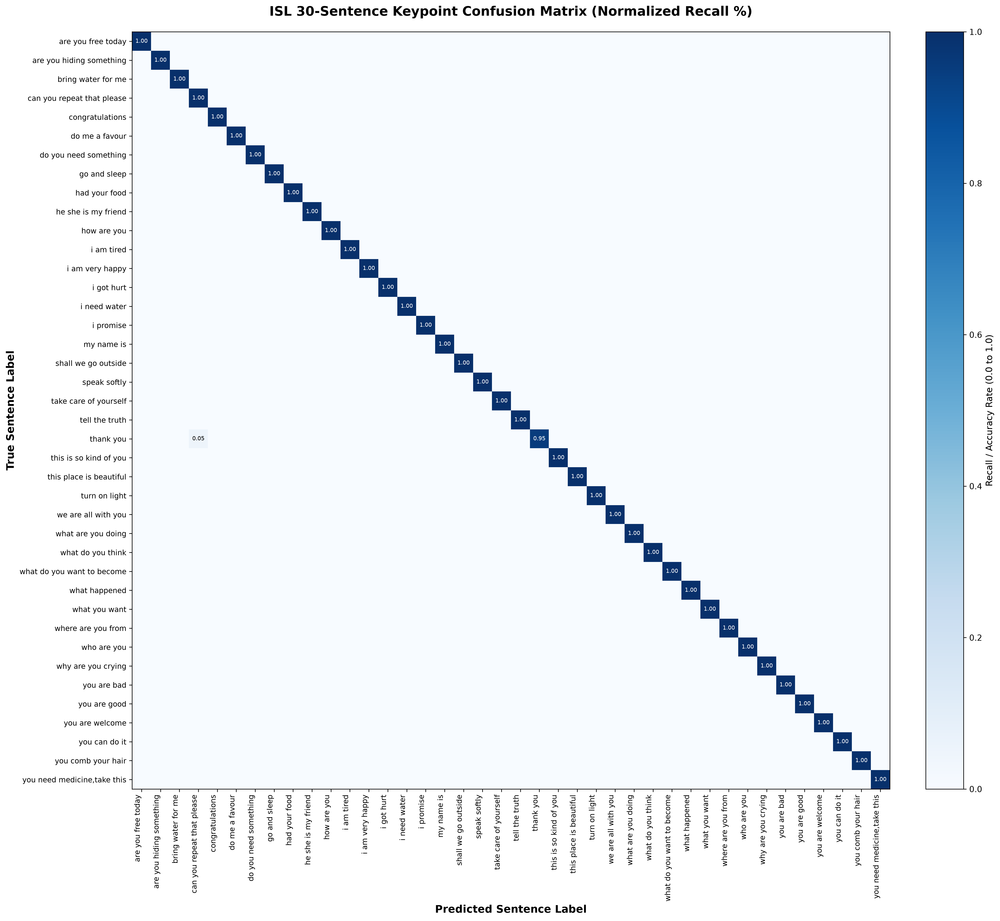

# 🤟 ISL Sentence Translator: Real-Time Indian Sign Language Recognition

**A real-time Indian Sign Language (ISL) translator that recognizes 46 conversational sentences from a live webcam and speaks them aloud in the browser.**


<!-- Add a demo GIF or screenshot here, e.g. . A 10-second screen recording of the translator page is the best thing you can add to this repo. -->

## Overview

Communication between sign language users and non-signers is hard. This project watches a webcam, extracts body and hand landmarks, classifies the signed sentence, shows it on screen, and reads it aloud with browser text-to-speech.

Instead of classifying raw video frames, the model works on **skeleton data** (MediaPipe Holistic landmarks). This makes it much less sensitive to lighting, background, clothing and camera distance than a pixel-based CNN.

## Features

- 🎥 **Live webcam recognition** of 46 conversational ISL sentences
- 🧍 **Pose and hand landmarks** from MediaPipe Holistic, normalized to the signer's body
- 🧠 **1D-CNN + Bi-LSTM** sequence model built in PyTorch
- ⚡ **Real-time web app** (Flask) with live video streaming and instant prediction
- 🔊 **Browser text-to-speech** that speaks each recognized sentence once, with a mute toggle
- 🛡️ **Reliable output:** motion gating, confidence thresholds, prediction smoothing and a cooldown stop false or repeated triggers

## How It Works

```text
Webcam frame
  → MediaPipe Holistic (pose + both hands)
  → 235 values per frame (body-relative landmarks + finger angles)
  → 35-frame window + frame-to-frame velocity → 470 features per frame
  → 1D-CNN → Bi-LSTM → softmax over 46 sentences
  → confidence check + cooldown → sentence locked
  → shown in the web UI and spoken with browser TTS
```

**Feature engineering:** the nose is the origin, the shoulder distance is the scale unit, and finger flexion angles describe hand shape. Because of this, the same sign looks similar whether the signer sits closer, farther or off-center.

**Model:** two Conv1D blocks (470 → 256 → 128) with batch norm and dropout, a 2-layer bidirectional LSTM (128 hidden units), and a fully connected classification head. Trained with AdamW, label smoothing (0.1) and early stopping.

## Results

| Evaluation | Accuracy |
|---|---|
| Held-out 15% stratified split (138 sequences) | 100.00% |
| Full-dataset diagnostic (919 of 920 sequences correct) | 99.89% |

<p align="center">
  
</p>

> **Honest note:** the dataset is a single signer, with each sentence recorded once and extended with 19 augmented variants. These scores therefore show the model fits this dataset very well, but they overstate how it would do with a new signer. Signer-independent testing is the main next step.

## Dataset

- **46 sentences × 20 videos = 920 sequences**
- 1 real webcam recording per sentence (640×480, ~7 seconds), plus 19 augmented variants:
  - slow and fast playback (0.80× to 1.40×)
  - horizontal shifts and zoom in/out
  - brightness and contrast changes
- The raw videos are not in this repository because of their size and because they contain personal video.

<details>
<summary><b>All 46 supported sentences</b></summary>

are you free today · are you hiding something · bring water for me · can you repeat that please · congratulations · do me a favour · do you need something · go and sleep · had your food · he/she is my friend · help me · how are you · i am afraid of that · i am feeling cold · i am having fever · i am hungry · i am tired · i am very happy · i appreciate it · i got hurt · i need water · i promise · my name is · shall we go outside · speak softly · take care of yourself · tell the truth · thank you · this is so kind of you · this place is beautiful · turn on light · we are all with you · what are you doing · what do you think · what do you want to become · what happened · what you want · where are you from · who are you · why are you crying · you are bad · you are good · you are welcome · you can do it · you comb your hair · you need medicine, take this

</details>

## Getting Started

**Requirements:** a webcam and Python 3.12 (the project was built and tested with it; the pinned MediaPipe version needs a compatible Python).

```bash
# 1. Clone the repository
git clone https://github.com/harshali8112/Implemented-AI-Based-Indian-Sign-Language-Sentence-Recognition-Learning-and-Translation-System.git
cd Implemented-AI-Based-Indian-Sign-Language-Sentence-Recognition-Learning-and-Translation-System

# 2. Create and activate a virtual environment
python -m venv .venv
.venv\Scripts\activate        # Windows
# source .venv/bin/activate   # macOS / Linux

# 3. Install dependencies
pip install -r requirements.txt

# 4. Run the web app (the trained model is already included)
python app.py
```

Open **http://127.0.0.1:5000**, go to the **Translator** page and allow camera access.

### Retrain on your own data (optional)

```bash
python recorder.py                       # record sentence videos
python record_one_and_generate_variants.py   # record one clip and auto-generate 19 variants
python videos_to_keypoints.py            # convert videos to keypoint sequences
python train_keypoint_model.py           # train and save isl_keypoint_model.pth
python evaluate_confusion.py             # confusion matrices and per-class metrics
```

<!-- Add the dataset download link here, e.g. "Dataset: [Google Drive](https://...)" so others can retrain. -->

## Project Structure

```text
├── app.py                              # Flask server + live inference worker
├── keypoint_features.py                # MediaPipe feature extraction (shared by training and inference)
├── train_keypoint_model.py             # 1D-CNN + Bi-LSTM model and training loop
├── videos_to_keypoints.py              # videos → (35, 470) keypoint sequences
├── record_one_and_generate_variants.py # record 1 clip, generate 19 augmented variants
├── augment_dataset_from_one_clip.py    # augmentation helpers
├── recorder.py                         # webcam recorder for dataset creation
├── evaluate_confusion.py               # evaluation and confusion matrices
├── live_inference.py                   # standalone OpenCV live demo
├── generate_project_diagrams.py        # architecture and flow diagrams
├── isl_keypoint_model.pth              # trained model checkpoint
├── templates/                          # web pages (home, translator, feedback)
├── static/                             # CSS / JS assets
├── docs/                               # project documentation and result plots
└── requirements.txt
```

## Tech Stack

| Area | Technology |
|---|---|
| Landmark detection | MediaPipe Holistic |
| Model | PyTorch (1D-CNN + Bi-LSTM) |
| Backend | Python, Flask, OpenCV |
| Frontend | HTML, CSS, JavaScript, Web Speech API (text-to-speech) |

## Limitations and Future Work

- Single-signer dataset: add more signers for real generalization
- Fixed vocabulary of 46 sentences, not open-ended translation
- MediaPipe can miss badly occluded hands
- Next steps: signer-independent test set, more sentences, a learning mode for beginners

## Documentation

Full design notes, preprocessing details and evaluation are in [`docs/PROJECT_MASTER_DOCUMENTATION.md`](docs/PROJECT_MASTER_DOCUMENTATION.md).

---

👩‍💻 Built by [Harshali](https://github.com/harshali8112) · 📫 info.harshali268@gmail.com
